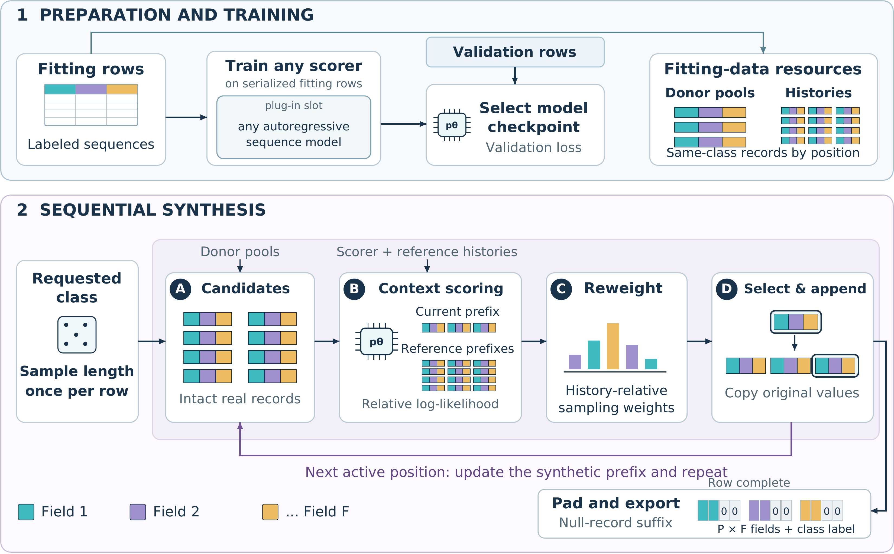

<div align="center">
  

  
  
  
</div>

NeTab synthesizes prefix-padded tables by selecting whole empirical records with a configurable compatibility scorer.
Originally developed for packet-level network-traffic tables.

## Table of contents

- [What is NeTab?](#what-is-netab)
- [How it works](#how-it-works)
- [Key features](#key-features)
- [Installation](#installation)
- [Quickstart](#quickstart)
- [Built-in scorers](#built-in-scorers)
- [Using your own data](#using-your-own-data)
- [Training a scorer](#training-a-scorer)
- [Project structure](#project-structure)
- [Documentation](#documentation)
- [Development](#development)
- [Citation](#citation)
- [License](#license)

## What is NeTab?

NeTab separates two questions: which values a record can take, and how records are combined into a row.
An empirical proposal supplies lengths and complete records from fitting data.
A scorer evaluates how well each candidate fits the generated history, relative to independent reference histories.
Copying validated records and appending a configured null record preserves the schema's record domain and prefix padding.

The schema defines the maximum number of records, field names and types, activity predicate, and record validity rules.
The library makes no assumption about a particular record width or field naming convention.

> [!NOTE]
> Record validity and padding are structural guarantees. They do not guarantee
> cross-record consistency, privacy, or a particular downstream utility.

## How it works



For candidate $c$, generated history $h$, reference histories $\bar h^{(m)}$,
and requested class $a$, the relative score and candidate probabilities are

$$
\ell(c) = \frac{1}{M}\sum_{m=1}^{M} S_\theta(c \mid \bar h^{(m)},a)
          - S_\theta(c \mid h,a),
\qquad
\pi_k = \frac{\exp(\ell(c_k)/\tau)}{\sum_{r=1}^{K}\exp(\ell(c_r)/\tau)}.
$$

The scorer returns mean negative log likelihood of candidate value tokens.
Quantization affects scoring; output values come from the original record.
Candidates are sampled with replacement and duplicate slots remain distinct.
See [concepts](docs/concepts.md) for the reference correction and finite-candidate sampling interpretation.

## Key features

| Feature | Behavior |
| --- | --- |
| Configurable schema | Maximum positions, field types, activity, null record, and validation |
| Empirical proposal | Class- and position-specific donor pools and empirical lengths |
| Reference bank | Independent position donors, shared for a class, seed, and target length |
| Selection rules | Relative scoring by default; uniform and absolute alternatives |
| Scorer interface | Implement `score(candidate, history, label)` and optionally batch queries |
| Numeric quantization | Per-field scoring vocabularies with negative, zero, and overflow handling |
| Raw-record output | Copy all fields together and append exact null padding |
| Training | Next-token training with checkpoint selection by validation token NLL |
| Hard constraints | Optional history-dependent candidate filtering before scoring |
| Command line | Validate data, train a scorer, and generate rows from YAML configuration |

## Installation

From the repository root:

```bash
pip install -e .
```

To use Hugging Face causal models:

```bash
pip install -e '.[hf]'
```

The core includes PyTorch for the Tiny scorer. Hugging Face dependencies are optional.
Neural scorers use `device="auto"`: CUDA when available, otherwise CPU.
Pass `device="cpu"` or CLI `--device cpu` to choose CPU explicitly.
Python 3.9 or newer is required; dependencies are declared in `pyproject.toml`.

## Quickstart

This example creates toy data in memory and writes no data files:

```python
from netab import Field, Schema, Quantizer, MarkovScorer
from netab import EmpiricalProposal, Generator, validate_rows

schema = Schema(positions=4, fields=[Field(name="amount", dtype="int", minimum=1)], null_record=(0,))
rows = [schema.pad(records=[(2,), (5,)]), schema.pad(records=[(7,)])]
labels = ["A", "A"]
proposal = EmpiricalProposal(schema=schema, rows=rows, labels=labels)
scorer = MarkovScorer(quantizer=Quantizer(schema=schema)).fit(rows=rows, labels=labels, schema=schema)
generator = Generator(proposal=proposal, scorer=scorer, k=8, m=4, temperature=1.0)
result = generator.generate(label="A", n=8, seed=42)
assert validate_rows(schema=schema, rows=result.rows)
print(len(result.rows))
```

Or run the self-contained CLI example:

```bash
netab quickstart --rows 16 --seed 42
python examples/01_quickstart_synthetic_toy.py
```

> [!TIP]
> Start with Markov and a small candidate count to check a new schema.
> Inspect activity and null padding before fitting a neural scorer.

## Built-in scorers

Sizes below describe implementation structure, not measured benchmark results.
`V` is the scorer vocabulary size and `T` its context capacity.
GPU availability is optional; neural scorers support CPU and CUDA.

| Scorer | Size (parameters) | GPU required | Relative speed | When to use |
| --- | --- | --- | --- | --- |
| `MarkovScorer` | No neural parameters; sparse count state depends on data | No | Usually fastest | Lightweight fitting and local record dependencies |
| `TinyTransformerScorer` | Schema-dependent; default `1,580,032 + 256(V + T)` tied parameters | Optional | Moderate | A trainable causal scorer with a compact configurable architecture |
| `HFCausalLMScorer` | Depends on the selected model and extended vocabulary | Recommended | Model-dependent, often slower | Pretrained or randomly initialized Hugging Face causal models |

The Tiny defaults are two layers, width 256, and four attention heads.
Markov conditions on position, the preceding quantized record, and preceding fields of the current record.
The Hugging Face wrapper tracks every token belonging to a candidate value, including values encoded as multiple tokens.
Its optional per-value averaging is disabled by default.
Details and a plug-in example appear in [scorers](docs/scorers.md).

For an empirical evaluation, see the accompanying paper.

## Using your own data

Represent a row as exactly `P` records, each containing the schema's `F` fields.
Active records must form a prefix; every remaining record equals `null_record`.
Use a callable for custom activity or joint record validation in the Python API.
YAML configurations support field types, bounds, choices, and a designated activity field.

The CSV adapter maps field names to position-indexed column patterns and preserves raw cell text.
Give the generator fitting data only; keep validation data separate when training a neural scorer.
See [data format](docs/data_format.md) and [configuration](docs/configuration.md).

`configs/cesnet_quic22.yaml` demonstrates a traffic schema with timing, direction, and size.
`examples/04_cesnet_quic22.py` uses an existing adapted local CSV and can open the official download page.
No dataset or generated table is distributed here.

## Training a scorer

The Python trainer accepts fitting rows and separate validation rows.
It minimizes next-token loss over serialized active records, including structural tokens,
and restores the epoch with the lowest validation token NLL.

```python
import torch
from netab import Serializer
from netab.scorers.tiny import TinyTransformerScorer
from netab.training import fit_scorer

torch.manual_seed(7)
serializer = Serializer(schema=schema, quantizer=Quantizer(schema=schema))
scorer = TinyTransformerScorer(serializer=serializer, classes=["A"], device="auto")
metadata = fit_scorer(
    scorer=scorer,
    train_rows=rows[:1],
    train_labels=labels[:1],
    validation_rows=rows[1:],
    validation_labels=labels[1:],
    epochs=1,
    device="auto",
)
```

The final toy row above is reserved for validation.
Use separate validation examples for checkpoint selection in an application.
See [CLI commands](docs/cli.md) for CSV-based training and generation.

## Project structure

```text
.
├── README.md                     # Introduction and quickstart
├── docs/
│   ├── concepts.md               # Algorithm, correction, invariance, sampling
│   ├── data_format.md            # Schemas, CSV layout, and validity guarantees
│   ├── scorers.md                # Built-in scorers and custom implementations
│   ├── configuration.md          # Parameters, defaults, and practical choices
│   ├── cli.md                    # Commands and usage examples
│   └── faq.md                    # Common questions and troubleshooting
├── images/
│   ├── NeTab_logo.png            # Project logo
│   ├── NeTab_framework_overview.png  # Framework overview
│   └── NeTab_traffic_instantiation.png  # Traffic record and scoring example
├── src/netab/
│   ├── __init__.py               # Public core API
│   ├── schema.py                 # Field domains, activity, padding
│   ├── quantize.py               # Per-field scoring transformations
│   ├── serialize.py              # Structural pieces and value locations
│   ├── proposal.py               # Empirical lengths and donor pools
│   ├── references.py             # Independent reference histories
│   ├── selection.py              # Scores, softmax, categorical selection
│   ├── generator.py              # Record-by-record synthesis
│   ├── validate.py               # Structural validation entry point
│   ├── io.py                     # Configurable CSV input and output
│   ├── devices.py                # Automatic or explicit CPU/CUDA selection
│   ├── training.py               # Training and validation selection
│   ├── cli.py                    # Command-line interface and toy data
│   └── scorers/
│       ├── base.py               # Scorer contract and batching hook
│       ├── markov.py             # Smoothed counts and backoff
│       ├── tiny.py               # Small causal Transformer
│       └── hf.py                 # Hugging Face causal model wrapper
├── configs/                      # Generic and traffic usage examples
├── examples/                     # In-memory toy and schema/scorer examples
├── tests/                        # Unit and validity checks on toy data
├── pyproject.toml                # Package, dependencies, and CLI entry point
├── requirements.txt              # Editable local installation
├── MANIFEST.in                   # Source archive contents
├── LICENSE                       # MIT terms
├── CITATION.cff                  # Software citation metadata
├── CHANGELOG.md                  # Version history
├── CONTRIBUTING.md               # Development workflow
└── .gitignore                    # Excludes data and generated artifacts
```

## Documentation

- [Concepts](docs/concepts.md): algorithm and interpretation.
- [Data format](docs/data_format.md): define and validate a schema.
- [Scorers](docs/scorers.md): choose or implement a scorer.
- [Configuration](docs/configuration.md): defaults and customization.
- [CLI](docs/cli.md): commands with local input/output examples.
- [FAQ](docs/faq.md): expected behavior and troubleshooting.

## Development

```bash
pip install -e '.[hf,dev]'
ruff check .
pytest
python -m build
```

Tests construct toy data, models, and tokenizers locally.
See [contributing](CONTRIBUTING.md) for the development workflow.

## Citation

```bibtex
@software{goldfryd2026netab,
  author = {Ori Goldfryd},
  title = {NeTab: A Framework for Record-Structured Tabular Synthesis},
  year = {2026},
  version = {0.1.0}
}
```

Software metadata is provided in [CITATION.cff](CITATION.cff).

## License

[MIT](LICENSE), Copyright (c) 2026 Ori Goldfryd.
