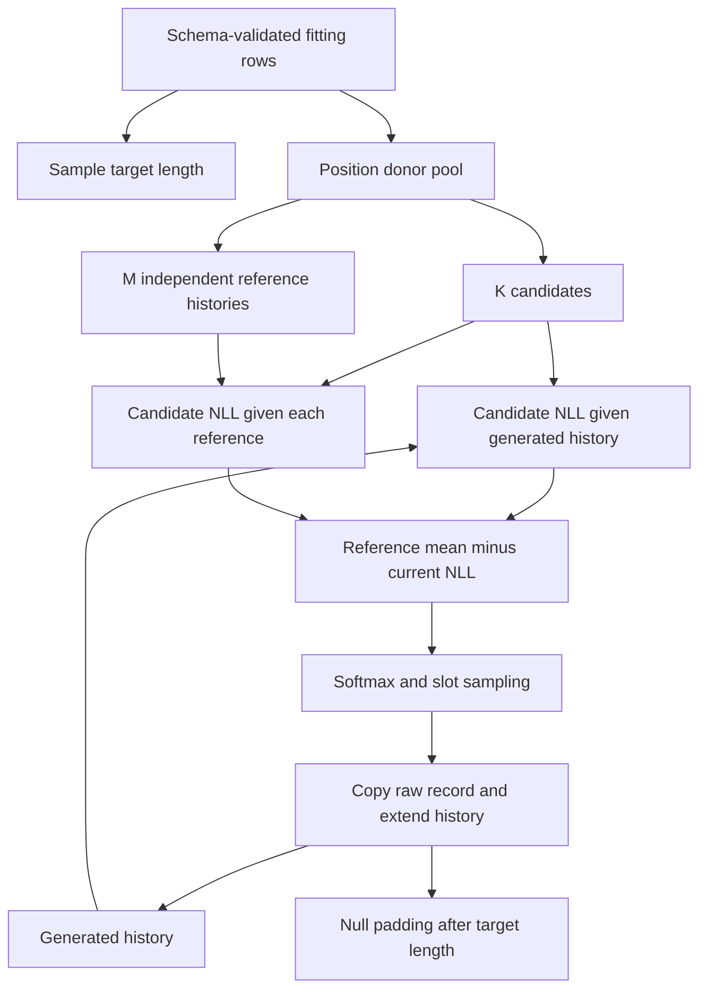

# Concepts

A row contains a prefix of `L` active records followed by null records up to a
schema capacity `P`. Each record has the same ordered fields. The class label `a`
conditions both proposal sampling and compatibility scoring.

## Empirical proposal

For class `a` and zero-based position `j`, the donor pool contains fitting rows
of that class whose active length exceeds `j`. A candidate is the whole raw
record at that position in a sampled donor. Field combinations within a record
are preserved because fields are never sampled separately.

A length donor is sampled uniformly from the fitting rows of the class. Its
length determines `L`, which therefore follows the empirical class length
histogram. At each active position the proposal samples `K` candidate slots
with replacement. Duplicates remain separate slots and receive separate mass.

## Independent reference histories

For each class, generation seed, and target length, construct `M` reference
histories. Every reference position independently samples its donor from the
same class/position pool. A reference is not necessarily an intact fitting row.
The bank is shared across generated rows of that target length within the call.



## Relative score and reference correction

Throughout, `c` denotes a candidate, `a` the requested class, and `h` the
generated history; `h̄^(m)` denotes a reference history and `τ` the temperature.

Let `S_θ(c | h, a)` be the scorer's mean candidate-value token NLL, excluding class
and structural token losses. Define the reference baseline

```text
β(c, a, L, j) = (1/M) Σ_m S_θ(c | h̄^(m), a)
ℓ(c) = β(c, a, L, j) - S_θ(c | h, a)
π_k ∝ exp(ℓ(c_k) / τ)
```

The reference correction rewards a candidate when its compatibility with the
current history is better than its average compatibility with reference
histories. The baseline is candidate-specific, so it is not a constant that can
simply be removed from a relative softmax.

At the first position, current and reference histories are all empty. Relative
scores are exactly zero and the implementation uses a uniform distribution.
Absolute selection still uses the scorer at this position.

## Invariance

Add any candidate-dependent term `b(c, a, j)` that does not depend on history
to the score. It appears in both the reference baseline and current score and
cancels in `ℓ`. This cancellation does not hold for arbitrary history-dependent
changes. Temperature rescales the remaining relative scores and changes selection.

## Sampling importance resampling

For a fixed history and reference bank, candidate slots are draws from the
empirical proposal `q_j(c | a)`. Selecting a slot with normalized weight
`exp(ℓ(c)/τ)` is a sampling importance resampling step.
Its large-candidate target is proportional to

```text
q_j(c | a) * exp(ℓ(c) / τ).
```

A finite candidate set produces a resampled approximation, not an exact draw
from that target. Repeated raw records accumulate the probability of their
slots. Reference-bank randomness is another source of variation; increasing
`M` changes the estimated baseline rather than the donor support.

## Alternative selection rules

- `uniform`: every candidate slot has equal probability; no scorer is needed.
- `absolute`: normalize `exp(-S_θ(c | h, a)/τ)` across slots.
- `relative`: normalize the reference-corrected scores above.

## Guarantees and limits

V1 checks a contiguous active prefix followed by exact null padding. V2 checks
each active record against the field domains and optional joint predicate.
Valid fitting donors and whole-record copying preserve both properties.
The final padded row is validated again before it is returned.

The method does not enforce global row constraints such as monotone clocks,
conservation laws, or protocol state transitions unless enforced by a history-dependent `candidate_filter` or additional
application logic. The optional filter removes sampled slots before scoring,
renormalizes the remaining weights, and raises an error when no slots remain. Empirical copying provides neither differential privacy nor
a guarantee against copying an entire fitting row.
