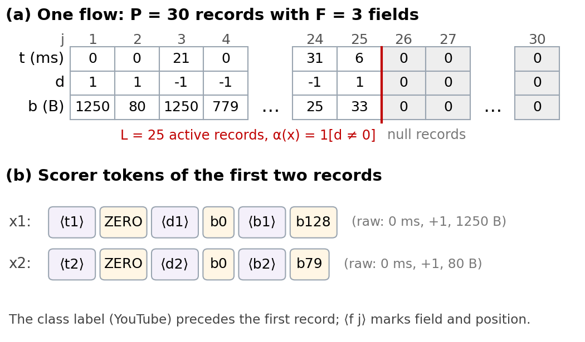

# Data format

## Python rows

A dataset is a list of rows and an equally long list of class labels. Each row
contains exactly `schema.positions` records. Records are tuples or sequences in
the same order as `schema.fields`. No label is part of a record.

```python
from netab import Field, Schema

schema = Schema(
    positions=5,
    fields=[Field("amount", "int", minimum=1), Field("direction", "int", choices=(-1, 1))],
    null_record=(0, 0),
    activity_field="direction",
)
row = schema.pad([(12, 1), (8, -1)])
assert schema.length(row) == 2
```

Activity means the designated field differs from `inactive_value` (default zero).
If no activity field is supplied, a record is active when it differs from the
null record, using numeric equality for numeric fields. Zero-valued fields may
therefore occur in active records when another field establishes activity.
An entirely null row is permitted and has length zero.

Field types are `int`, `float`, and `str`. Numeric fields accept numeric CSV
strings without replacing their raw representation. Integer fields reject
fractional or nonfinite values. Bounds and `choices` constrain active values.
The null record is exempt from active-value bounds but must be inactive.

For richer logic, Python schemas accept `activity(record)` and
`record_validator(record)` callables. The validator checks joint constraints
inside an active record. It does not inspect other records. These callables
are Python API features and are not evaluated from YAML.

## CSV layout

CSV data uses one column for each field/position pair plus a class column.
Column patterns are specified in the `data` configuration. The adapter reads
fields by name and writes them in field-major order. Extra input columns are
ignored; missing or duplicate columns are rejected. Output is created
exclusively and an existing output file is not overwritten.

```yaml
data:
  class_column: class
  columns:
    amount: 'amount_{j}'
    direction: 'direction_{j}'
```

`{j}` is zero-based. If column mappings are omitted the pattern is
`<field_name>_{j}`. All padding cells must equal the schema's null record;
empty CSV cells are not an implicit padding representation.

## CESNET-QUIC22 usage example



The supplied traffic configuration uses capacity 30 and the ordered fields
`timing`, `direction`, and `size`. It maps them to `PPI_0_{j}`, `PPI_1_{j}`, and
`PPI_2_{j}`, with class column `APP`. Activity is `direction != 0`, active
directions are `-1` or `1`, timing and size are nonnegative, and null records
are `(0, 0, 0)`. An active record may have zero timing.

The illustration uses one-based record positions and bin indices `b_i`. In the
serializer, position markers are zero-based and numeric symbols use
`<VAL_representative>` spelling; `ZERO` is `<VAL_ZERO>`. These are equivalent
ways to label the scoring bins, not changes to the raw values.

These are choices made by the example configuration, not library constants.
The example expects an already adapted wide CSV; it does not parse the native
archive or infer its physical units.

Obtain source data from the [official CESNET-QUIC22 record](https://zenodo.org/records/10728760).
The record's dataset license is CC BY 4.0; cite its creators and follow those
terms when using it. The library's MIT license applies to the software.
No source data or generated tables are included in this repository.

## Scoring transformations

The default logarithmic quantizer is numeric. String fields require a custom
per-field callable with a finite `vocabulary` attribute when using built-in
scorers. For example, map a finite category set to distinct value symbols.
All built-in scorers receive raw records and transform them only for scoring.

## What validation guarantees

| Property | Scope |
| --- | --- |
| V1 | Active records form a prefix; every trailing record equals the null record |
| V2 | Every active record satisfies field types, bounds, choices, and the record predicate |
| Raw support | Generated active records come from fitting donors of the same class and position |

Validation cannot infer physical units, dataset representativeness, independence,
or cross-record relationships. Review such requirements in the application.

## New field types and categorical values

String fields are supported by schema validation. Supply a finite vocabulary
quantizer for such a field through the Python API. The default logarithmic
quantizer accepts only finite numeric values. All output fields remain raw.
